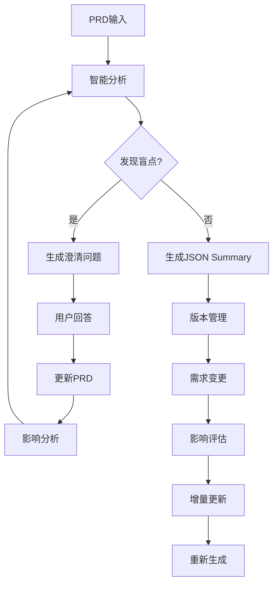

# 迭代式 Clarifier 系统设计

## 核心理念

将需求管理视为**活文档**，支持：
1. **智能盲点发现** - 主动识别 PRD 中的潜在问题
2. **版本化管理** - 追踪每次变更的影响
3. **增量式重构** - 局部修改，全局更新

## 系统架构



## 1. 智能盲点发现系统

### 1.1 盲点类型定义

```python
from enum import Enum
from typing import List, Dict, Any
import re

class BlindSpotType(Enum):
    """需求盲点类型"""
    EDGE_CASE = "edge_case"  # 边界情况
    SCALABILITY = "scalability"  # 可扩展性问题
    SECURITY = "security"  # 安全考虑
    USER_EXPERIENCE = "user_experience"  # 用户体验细节
    INTEGRATION = "integration"  # 集成需求
    PERFORMANCE = "performance"  # 性能要求
    ERROR_HANDLING = "error_handling"  # 错误处理
    DATA_CONSISTENCY = "data_consistency"  # 数据一致性
    REGULATORY = "regulatory"  # 法规合规
    BUSINESS_LOGIC = "business_logic"  # 业务逻辑完整性

class BlindSpotDetector:
    """PRD 盲点检测器"""
    
    def __init__(self):
        self.blind_spot_patterns = self._init_patterns()
        self.domain_specific_checks = self._init_domain_checks()
    
    def _init_patterns(self) -> Dict[BlindSpotType, List[Dict]]:
        """初始化盲点检测模式"""
        return {
            BlindSpotType.EDGE_CASE: [
                {
                    "pattern": "用户.*上传",
                    "missing": "文件大小限制、文件类型限制、并发上传",
                    "questions": [
                        "文件大小限制是多少？",
                        "支持哪些文件格式？",
                        "用户同时可以上传多少个文件？",
                        "上传失败如何处理？"
                    ]
                },
                {
                    "pattern": "删除.*数据",
                    "missing": "软删除vs硬删除、数据恢复、级联删除",
                    "questions": [
                        "删除的数据是否需要保留？保留多久？",
                        "删除操作是否可以撤销？",
                        "关联数据如何处理？"
                    ]
                }
            ],
            BlindSpotType.SCALABILITY: [
                {
                    "pattern": "用户.*数量|客户.*管理",
                    "missing": "并发用户数、数据增长预期",
                    "questions": [
                        "系统需要支持多少并发用户？",
                        "数据量增长预期如何？",
                        "是否需要分页、搜索、筛选功能？"
                    ]
                }
            ],
            BlindSpotType.SECURITY: [
                {
                    "pattern": "登录|认证|用户信息",
                    "missing": "密码策略、会话管理、权限控制",
                    "questions": [
                        "密码复杂度要求是什么？",
                        "会话超时时间是多久？",
                        "是否需要多因素认证？",
                        "不同角色的权限如何区分？"
                    ]
                }
            ],
            BlindSpotType.ERROR_HANDLING: [
                {
                    "pattern": "支付|交易|转账",
                    "missing": "失败重试、事务回滚、异常通知",
                    "questions": [
                        "支付失败如何处理？",
                        "是否需要自动重试？",
                        "如何保证交易的原子性？",
                        "异常情况如何通知相关人员？"
                    ]
                }
            ]
        }
    
    async def detect_blind_spots(self, prd_content: str) -> List[Dict[str, Any]]:
        """检测 PRD 中的盲点"""
        blind_spots = []
        
        # 1. 模式匹配检测
        for spot_type, patterns in self.blind_spot_patterns.items():
            for pattern_config in patterns:
                if re.search(pattern_config["pattern"], prd_content, re.IGNORECASE):
                    # 检查是否已经涵盖了相关内容
                    if not self._is_addressed(prd_content, pattern_config["missing"]):
                        blind_spots.append({
                            "type": spot_type.value,
                            "context": pattern_config["pattern"],
                            "missing": pattern_config["missing"],
                            "questions": pattern_config["questions"],
                            "severity": self._assess_severity(spot_type)
                        })
        
        # 2. 领域特定检测
        domain_blind_spots = await self._detect_domain_specific(prd_content)
        blind_spots.extend(domain_blind_spots)
        
        # 3. AI 深度分析
        ai_blind_spots = await self._ai_deep_analysis(prd_content)
        blind_spots.extend(ai_blind_spots)
        
        # 按严重程度排序
        blind_spots.sort(key=lambda x: x["severity"], reverse=True)
        
        return blind_spots
    
    def _is_addressed(self, content: str, missing_aspects: str) -> bool:
        """检查内容是否已经涵盖了缺失的方面"""
        keywords = missing_aspects.split("、")
        addressed_count = sum(1 for keyword in keywords if keyword in content)
        return addressed_count >= len(keywords) * 0.5  # 如果覆盖了50%以上认为已处理
    
    async def _ai_deep_analysis(self, prd_content: str) -> List[Dict[str, Any]]:
        """使用 AI 进行深度盲点分析"""
        from llm_services.executor import run_prompt
        
        analysis_prompt = """
        分析以下 PRD 文档，识别潜在的需求盲点和未考虑的情况。
        
        重点关注：
        1. 异常场景和边界情况
        2. 性能和扩展性考虑
        3. 安全和隐私问题
        4. 用户体验细节
        5. 数据一致性和完整性
        6. 与其他系统的集成
        7. 法规和合规要求
        
        对于每个发现的盲点，提供：
        - 盲点类型
        - 具体描述
        - 可能的影响
        - 建议的澄清问题
        
        PRD内容：
        {content}
        
        请以JSON格式输出盲点列表。
        """
        
        response = await run_prompt(
            system_message="你是一个经验丰富的产品经理，擅长发现需求文档中的潜在问题",
            user_message=analysis_prompt.format(content=prd_content)
        )
        
        # 解析 AI 响应
        try:
            import json
            blind_spots = json.loads(response)
            return [self._format_ai_blind_spot(spot) for spot in blind_spots]
        except:
            return []
    
    def _format_ai_blind_spot(self, ai_spot: Dict) -> Dict[str, Any]:
        """格式化 AI 发现的盲点"""
        return {
            "type": "ai_discovered",
            "context": ai_spot.get("description", ""),
            "missing": ai_spot.get("missing_consideration", ""),
            "questions": ai_spot.get("clarification_questions", []),
            "severity": ai_spot.get("severity", "medium"),
            "ai_confidence": ai_spot.get("confidence", 0.8)
        }
```

### 1.2 交互式盲点澄清

```python
class InteractiveBlindSpotClarifier:
    """交互式盲点澄清器"""
    
    def __init__(self, detector: BlindSpotDetector):
        self.detector = detector
        self.clarification_history = []
        self.prd_versions = []
    
    async def clarify_blind_spots(self, prd_content: str) -> Dict[str, Any]:
        """执行盲点澄清流程"""
        # 1. 检测盲点
        blind_spots = await self.detector.detect_blind_spots(prd_content)
        
        if not blind_spots:
            return {
                "status": "complete",
                "message": "未发现明显的需求盲点",
                "prd": prd_content
            }
        
        # 2. 生成澄清对话
        clarification_plan = self._create_clarification_plan(blind_spots)
        
        # 3. 返回第一个澄清问题
        return {
            "status": "clarifying",
            "total_blind_spots": len(blind_spots),
            "current_blind_spot": blind_spots[0],
            "questions": blind_spots[0]["questions"],
            "clarification_plan": clarification_plan
        }
    
    def _create_clarification_plan(self, blind_spots: List[Dict]) -> Dict[str, Any]:
        """创建澄清计划"""
        # 按类型分组
        grouped = {}
        for spot in blind_spots:
            spot_type = spot["type"]
            if spot_type not in grouped:
                grouped[spot_type] = []
            grouped[spot_type].append(spot)
        
        # 创建澄清路线图
        plan = {
            "total_issues": len(blind_spots),
            "by_type": {k: len(v) for k, v in grouped.items()},
            "estimated_time": len(blind_spots) * 2,  # 每个盲点约2分钟
            "priority_order": [spot["type"] for spot in blind_spots]
        }
        
        return plan
    
    async def process_clarification_response(
        self, 
        blind_spot: Dict, 
        user_response: str,
        current_prd: str
    ) -> Dict[str, Any]:
        """处理用户的澄清回复"""
        # 1. 记录澄清历史
        self.clarification_history.append({
            "blind_spot": blind_spot,
            "response": user_response,
            "timestamp": "2024-01-01"  # 实际应该是当前时间
        })
        
        # 2. 更新 PRD
        updated_prd = await self._update_prd_with_clarification(
            current_prd, 
            blind_spot, 
            user_response
        )
        
        # 3. 保存版本
        self.prd_versions.append({
            "version": len(self.prd_versions) + 1,
            "prd": updated_prd,
            "change_summary": f"澄清了{blind_spot['type']}相关需求"
        })
        
        return {
            "updated_prd": updated_prd,
            "change_summary": self._generate_change_summary(blind_spot, user_response)
        }
    
    async def _update_prd_with_clarification(
        self, 
        prd: str, 
        blind_spot: Dict, 
        response: str
    ) -> str:
        """根据澄清内容更新 PRD"""
        from llm_services.executor import run_prompt
        
        update_prompt = f"""
        根据用户的澄清回复，更新 PRD 文档中的相关部分。
        
        原始 PRD：
        {prd}
        
        发现的盲点：
        类型：{blind_spot['type']}
        缺失内容：{blind_spot['missing']}
        
        用户澄清：
        {response}
        
        请更新 PRD，确保：
        1. 在适当的位置添加澄清的内容
        2. 保持文档的整体结构和格式
        3. 确保新内容与现有内容协调一致
        4. 在更新的部分添加 [已澄清] 标记
        
        返回更新后的完整 PRD。
        """
        
        updated_prd = await run_prompt(
            system_message="你是一个专业的技术文档编写者",
            user_message=update_prompt
        )
        
        return updated_prd
```

## 2. 版本化需求管理

### 2.1 需求版本控制

```python
from typing import List, Dict, Any, Optional
from datetime import datetime
import hashlib
import json

class RequirementVersion:
    """需求版本管理"""
    
    def __init__(self):
        self.versions: List[Dict[str, Any]] = []
        self.current_version: Optional[Dict[str, Any]] = None
        self.change_log: List[Dict[str, Any]] = []
    
    def create_version(
        self, 
        prd_content: str, 
        json_summary: Dict[str, Any],
        metadata: Dict[str, Any] = None
    ) -> str:
        """创建新版本"""
        version_id = self._generate_version_id(prd_content, json_summary)
        
        version = {
            "id": version_id,
            "version_number": len(self.versions) + 1,
            "created_at": datetime.now().isoformat(),
            "prd_content": prd_content,
            "json_summary": json_summary,
            "metadata": metadata or {},
            "checksum": self._calculate_checksum(json_summary)
        }
        
        self.versions.append(version)
        self.current_version = version
        
        return version_id
    
    def _generate_version_id(self, prd: str, summary: Dict) -> str:
        """生成版本ID"""
        content = f"{prd}{json.dumps(summary, sort_keys=True)}"
        return hashlib.sha256(content.encode()).hexdigest()[:12]
    
    def _calculate_checksum(self, summary: Dict) -> str:
        """计算内容校验和"""
        return hashlib.md5(
            json.dumps(summary, sort_keys=True).encode()
        ).hexdigest()
    
    def track_change(
        self,
        change_type: str,
        affected_component: str,
        old_value: Any,
        new_value: Any,
        impact_analysis: Dict[str, Any]
    ):
        """追踪变更"""
        change = {
            "timestamp": datetime.now().isoformat(),
            "type": change_type,
            "component": affected_component,
            "old_value": old_value,
            "new_value": new_value,
            "impact": impact_analysis,
            "version_before": self.current_version["id"] if self.current_version else None
        }
        
        self.change_log.append(change)
    
    def get_diff(self, version1_id: str, version2_id: str) -> Dict[str, Any]:
        """获取两个版本之间的差异"""
        v1 = next((v for v in self.versions if v["id"] == version1_id), None)
        v2 = next((v for v in self.versions if v["id"] == version2_id), None)
        
        if not v1 or not v2:
            return {"error": "版本不存在"}
        
        # 深度对比 JSON summary
        diff = self._deep_diff(v1["json_summary"], v2["json_summary"])
        
        return {
            "version1": version1_id,
            "version2": version2_id,
            "differences": diff,
            "summary": self._summarize_diff(diff)
        }
    
    def _deep_diff(self, obj1: Any, obj2: Any, path: str = "") -> List[Dict]:
        """深度对比两个对象"""
        differences = []
        
        if type(obj1) != type(obj2):
            differences.append({
                "path": path,
                "type": "type_change",
                "old": type(obj1).__name__,
                "new": type(obj2).__name__
            })
            return differences
        
        if isinstance(obj1, dict):
            all_keys = set(obj1.keys()) | set(obj2.keys())
            for key in all_keys:
                new_path = f"{path}.{key}" if path else key
                if key not in obj1:
                    differences.append({
                        "path": new_path,
                        "type": "added",
                        "value": obj2[key]
                    })
                elif key not in obj2:
                    differences.append({
                        "path": new_path,
                        "type": "removed",
                        "value": obj1[key]
                    })
                else:
                    differences.extend(
                        self._deep_diff(obj1[key], obj2[key], new_path)
                    )
        
        elif isinstance(obj1, list):
            if len(obj1) != len(obj2):
                differences.append({
                    "path": path,
                    "type": "list_length_change",
                    "old_length": len(obj1),
                    "new_length": len(obj2)
                })
            
            for i in range(min(len(obj1), len(obj2))):
                differences.extend(
                    self._deep_diff(obj1[i], obj2[i], f"{path}[{i}]")
                )
        
        elif obj1 != obj2:
            differences.append({
                "path": path,
                "type": "value_change",
                "old": obj1,
                "new": obj2
            })
        
        return differences
```

## 3. 增量式重构系统

### 3.1 变更影响分析

```python
class ChangeImpactAnalyzer:
    """变更影响分析器"""
    
    def __init__(self):
        self.dependency_graph = self._build_dependency_graph()
        self.impact_rules = self._define_impact_rules()
    
    def _build_dependency_graph(self) -> Dict[str, List[str]]:
        """构建功能依赖图"""
        return {
            "user_authentication": ["user_management", "session_management", "security"],
            "document_upload": ["storage", "file_validation", "user_permissions"],
            "notification": ["user_preferences", "communication_channels", "event_system"],
            "payment": ["user_account", "transaction_log", "financial_reporting"],
            # ... 更多依赖关系
        }
    
    def _define_impact_rules(self) -> Dict[str, Dict]:
        """定义影响规则"""
        return {
            "data_model_change": {
                "impacts": ["api", "database", "validation", "serialization"],
                "severity": "high",
                "requires_migration": True
            },
            "api_change": {
                "impacts": ["frontend", "documentation", "integration_tests"],
                "severity": "medium",
                "requires_versioning": True
            },
            "business_logic_change": {
                "impacts": ["unit_tests", "validation_rules", "error_handling"],
                "severity": "medium",
                "requires_review": True
            },
            "ui_change": {
                "impacts": ["user_experience", "accessibility", "responsive_design"],
                "severity": "low",
                "requires_design_review": True
            }
        }
    
    async def analyze_change_impact(
        self, 
        change_type: str,
        affected_feature: str,
        change_details: Dict[str, Any]
    ) -> Dict[str, Any]:
        """分析变更影响"""
        # 1. 直接影响
        direct_impacts = self._get_direct_impacts(change_type, affected_feature)
        
        # 2. 传递影响
        transitive_impacts = self._get_transitive_impacts(affected_feature)
        
        # 3. 风险评估
        risk_assessment = await self._assess_risks(
            change_type, 
            affected_feature, 
            change_details
        )
        
        # 4. 生成重构建议
        refactoring_suggestions = self._generate_refactoring_suggestions(
            change_type,
            affected_feature,
            direct_impacts + transitive_impacts
        )
        
        return {
            "change_summary": {
                "type": change_type,
                "feature": affected_feature,
                "details": change_details
            },
            "impact_analysis": {
                "direct_impacts": direct_impacts,
                "transitive_impacts": transitive_impacts,
                "total_affected_components": len(set(direct_impacts + transitive_impacts))
            },
            "risk_assessment": risk_assessment,
            "refactoring_plan": refactoring_suggestions,
            "estimated_effort": self._estimate_effort(direct_impacts + transitive_impacts)
        }
    
    def _get_direct_impacts(self, change_type: str, feature: str) -> List[str]:
        """获取直接影响"""
        impacts = []
        
        # 从影响规则获取
        if change_type in self.impact_rules:
            impacts.extend(self.impact_rules[change_type]["impacts"])
        
        # 从依赖图获取
        if feature in self.dependency_graph:
            impacts.extend(self.dependency_graph[feature])
        
        return list(set(impacts))
    
    def _get_transitive_impacts(self, feature: str, visited: set = None) -> List[str]:
        """获取传递影响"""
        if visited is None:
            visited = set()
        
        if feature in visited:
            return []
        
        visited.add(feature)
        impacts = []
        
        # 查找依赖这个功能的其他功能
        for f, deps in self.dependency_graph.items():
            if feature in deps and f not in visited:
                impacts.append(f)
                impacts.extend(self._get_transitive_impacts(f, visited))
        
        return impacts
    
    def _generate_refactoring_suggestions(
        self,
        change_type: str,
        feature: str,
        impacts: List[str]
    ) -> Dict[str, Any]:
        """生成重构建议"""
        suggestions = {
            "immediate_actions": [],
            "short_term_actions": [],
            "long_term_considerations": []
        }
        
        # 立即行动
        if "api" in impacts:
            suggestions["immediate_actions"].append({
                "action": "更新 API 文档",
                "priority": "high",
                "estimated_time": "2小时"
            })
        
        if "database" in impacts:
            suggestions["immediate_actions"].append({
                "action": "创建数据库迁移脚本",
                "priority": "critical",
                "estimated_time": "4小时"
            })
        
        # 短期行动
        if "unit_tests" in impacts:
            suggestions["short_term_actions"].append({
                "action": "更新相关单元测试",
                "priority": "high",
                "estimated_time": "1天"
            })
        
        # 长期考虑
        if len(impacts) > 5:
            suggestions["long_term_considerations"].append({
                "consideration": "考虑模块解耦",
                "reason": "变更影响范围过大",
                "benefit": "降低未来变更成本"
            })
        
        return suggestions
```

### 3.2 智能重构执行器

```python
class SmartRefactoring:
    """智能重构执行器"""
    
    def __init__(self, version_manager: RequirementVersion, impact_analyzer: ChangeImpactAnalyzer):
        self.version_manager = version_manager
        self.impact_analyzer = impact_analyzer
        self.refactoring_history = []
    
    async def handle_requirement_change(
        self,
        current_prd: str,
        current_summary: Dict[str, Any],
        change_request: Dict[str, Any]
    ) -> Dict[str, Any]:
        """处理需求变更"""
        # 1. 分析变更类型
        change_type = self._identify_change_type(change_request)
        
        # 2. 执行影响分析
        impact_analysis = await self.impact_analyzer.analyze_change_impact(
            change_type=change_type,
            affected_feature=change_request["feature"],
            change_details=change_request["details"]
        )
        
        # 3. 生成变更计划
        change_plan = self._create_change_plan(impact_analysis)
        
        # 4. 获取用户确认
        if change_plan["requires_confirmation"]:
            return {
                "status": "pending_confirmation",
                "change_plan": change_plan,
                "impact_analysis": impact_analysis,
                "confirmation_required": True
            }
        
        # 5. 执行变更
        updated_prd, updated_summary = await self._execute_change(
            current_prd,
            current_summary,
            change_request,
            change_plan
        )
        
        # 6. 创建新版本
        new_version_id = self.version_manager.create_version(
            updated_prd,
            updated_summary,
            metadata={
                "change_request": change_request,
                "impact_analysis": impact_analysis
            }
        )
        
        # 7. 记录重构历史
        self.refactoring_history.append({
            "timestamp": datetime.now().isoformat(),
            "change_request": change_request,
            "impact_analysis": impact_analysis,
            "new_version": new_version_id
        })
        
        return {
            "status": "completed",
            "new_version_id": new_version_id,
            "updated_prd": updated_prd,
            "updated_summary": updated_summary,
            "change_summary": self._summarize_changes(
                current_summary,
                updated_summary
            )
        }
    
    def _identify_change_type(self, change_request: Dict) -> str:
        """识别变更类型"""
        keywords = change_request.get("description", "").lower()
        
        if any(word in keywords for word in ["新增", "添加", "增加"]):
            return "feature_addition"
        elif any(word in keywords for word in ["删除", "移除", "去掉"]):
            return "feature_removal"
        elif any(word in keywords for word in ["修改", "更改", "调整"]):
            return "feature_modification"
        elif any(word in keywords for word in ["优化", "改进", "提升"]):
            return "optimization"
        else:
            return "general_change"
    
    async def _execute_change(
        self,
        prd: str,
        summary: Dict[str, Any],
        change_request: Dict[str, Any],
        change_plan: Dict[str, Any]
    ) -> tuple[str, Dict[str, Any]]:
        """执行变更"""
        # 1. 更新 JSON Summary
        updated_summary = self._update_json_summary(summary, change_request)
        
        # 2. 更新 PRD 文档
        updated_prd = await self._update_prd_document(prd, change_request, updated_summary)
        
        # 3. 验证一致性
        consistency_check = await self._verify_consistency(updated_prd, updated_summary)
        
        if not consistency_check["is_consistent"]:
            # 修复不一致
            updated_prd, updated_summary = await self._fix_inconsistencies(
                updated_prd,
                updated_summary,
                consistency_check["issues"]
            )
        
        return updated_prd, updated_summary
    
    def _update_json_summary(
        self,
        summary: Dict[str, Any],
        change_request: Dict[str, Any]
    ) -> Dict[str, Any]:
        """更新 JSON Summary"""
        import copy
        updated = copy.deepcopy(summary)
        
        feature = change_request["feature"]
        change_type = change_request["type"]
        details = change_request["details"]
        
        # 根据变更类型更新
        if change_type == "feature_addition":
            # 添加新功能
            if "functional_requirements" in updated:
                if "core_features" not in updated["functional_requirements"]:
                    updated["functional_requirements"]["core_features"] = []
                
                updated["functional_requirements"]["core_features"].append({
                    "name": feature,
                    "description": details.get("description", ""),
                    "priority": details.get("priority", "should-have"),
                    "acceptance_criteria": details.get("acceptance_criteria", [])
                })
        
        elif change_type == "feature_modification":
            # 修改现有功能
            if "functional_requirements" in updated and "core_features" in updated["functional_requirements"]:
                for i, feat in enumerate(updated["functional_requirements"]["core_features"]):
                    if feat["name"] == feature:
                        updated["functional_requirements"]["core_features"][i].update(details)
                        break
        
        # 更新元数据
        if "metadata" not in updated:
            updated["metadata"] = {}
        
        updated["metadata"]["last_modified"] = datetime.now().isoformat()
        updated["metadata"]["modification_reason"] = change_request.get("reason", "")
        
        return updated
```

## 4. 使用流程示例

### 4.1 带盲点检测的 PRD 优化流程

```python
async def optimize_prd_with_blind_spot_detection():
    """优化 PRD 的完整流程"""
    
    # 1. 初始化组件
    detector = BlindSpotDetector()
    clarifier = InteractiveBlindSpotClarifier(detector)
    version_manager = RequirementVersion()
    
    # 2. 加载原始 PRD
    original_prd = load_prd("original.md")
    
    # 3. 检测盲点
    blind_spots = await detector.detect_blind_spots(original_prd)
    
    print(f"发现 {len(blind_spots)} 个潜在盲点")
    
    # 4. 交互式澄清
    updated_prd = original_prd
    for spot in blind_spots:
        print(f"\n处理盲点: {spot['type']}")
        print(f"缺失考虑: {spot['missing']}")
        
        for question in spot['questions']:
            print(f"Q: {question}")
            user_response = input("A: ")  # 实际应该是 UI 交互
            
            # 更新 PRD
            result = await clarifier.process_clarification_response(
                spot, 
                user_response, 
                updated_prd
            )
            updated_prd = result["updated_prd"]
    
    # 5. 生成结构化 JSON
    json_summary = await generate_json_summary(updated_prd)
    
    # 6. 创建版本
    version_id = version_manager.create_version(updated_prd, json_summary)
    
    return {
        "optimized_prd": updated_prd,
        "json_summary": json_summary,
        "version_id": version_id,
        "blind_spots_resolved": len(blind_spots)
    }
```

### 4.2 快速重构示例

```python
async def quick_refactoring_example():
    """快速重构示例"""
    
    # 初始化
    refactoring = SmartRefactoring(version_manager, impact_analyzer)
    
    # 场景：用户想要修改上传文件的大小限制
    change_request = {
        "feature": "document_upload",
        "type": "feature_modification",
        "details": {
            "file_size_limit": "50MB",  # 原来是 10MB
            "supported_formats": ["pdf", "doc", "docx", "jpg", "png"]  # 新增图片格式
        },
        "reason": "用户反馈需要上传更大的文件和图片"
    }
    
    # 执行变更
    result = await refactoring.handle_requirement_change(
        current_prd,
        current_summary,
        change_request
    )
    
    # 查看影响
    print("影响分析:")
    print(f"- 直接影响: {result['impact_analysis']['direct_impacts']}")
    print(f"- 需要更新的组件: {result['impact_analysis']['total_affected_components']}")
    print(f"- 建议的重构步骤: {result['refactoring_plan']}")
    
    # 输出示例:
    # 影响分析:
    # - 直接影响: ['storage', 'file_validation', 'user_permissions']
    # - 需要更新的组件: 7
    # - 建议的重构步骤: 
    #   - 立即: 更新文件验证逻辑, 调整存储配额
    #   - 短期: 更新API文档, 添加图片预览功能
    #   - 长期: 考虑使用CDN优化大文件传输
```

## 5. 核心优势

1. **主动发现问题** - 不等用户提出，主动识别潜在问题
2. **版本可追溯** - 每次变更都有记录，可以回滚
3. **影响可预测** - 变更前就知道会影响哪些部分
4. **重构自动化** - 减少手动修改的工作量
5. **一致性保证** - PRD 和 JSON 始终保持同步

这个设计让需求管理变成了一个**活的系统**，而不是静态文档！