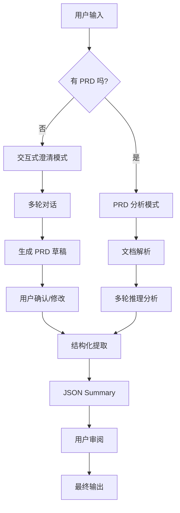

# Clarifier 系统架构设计

## 系统概述

Clarifier 是一个智能需求澄清和结构化系统，支持两种工作模式：
1. **交互式澄清模式** - 与非技术用户对话，逐步澄清需求
2. **PRD 分析模式** - 分析现有 PRD 文档，通过多轮推理提取结构化信息

两种模式最终都生成**统一的结构化 JSON Summary**。

## 工作流程



## 核心组件设计

### 1. 统一的 JSON Summary 结构

```json
{
  "project": {
    "name": "项目名称",
    "description": "项目描述",
    "type": "platform|system|app|website",
    "domain": "业务领域"
  },
  "business_context": {
    "problem_statement": "要解决的问题",
    "goals": ["业务目标1", "业务目标2"],
    "success_metrics": ["成功指标1", "成功指标2"],
    "scope": "项目范围"
  },
  "users": {
    "stakeholders": [
      {
        "type": "primary|secondary",
        "role": "用户角色",
        "description": "用户描述",
        "needs": ["需求1", "需求2"],
        "pain_points": ["痛点1", "痛点2"],
        "user_stories": ["作为X，我想要Y，以便Z"]
      }
    ],
    "estimated_users": "用户规模"
  },
  "functional_requirements": {
    "core_features": [
      {
        "name": "功能名称",
        "description": "功能描述",
        "priority": "must-have|should-have|nice-to-have",
        "acceptance_criteria": ["验收标准1", "验收标准2"]
      }
    ],
    "user_flows": [
      {
        "name": "流程名称",
        "steps": ["步骤1", "步骤2"],
        "actors": ["参与者"]
      }
    ]
  },
  "non_functional_requirements": {
    "performance": "性能要求",
    "security": "安全要求",
    "usability": "易用性要求",
    "scalability": "可扩展性要求"
  },
  "constraints": {
    "technical": ["技术约束"],
    "business": ["业务约束"],
    "regulatory": ["法规约束"],
    "timeline": "时间限制",
    "budget": "预算范围"
  },
  "assumptions": ["假设1", "假设2"],
  "risks": ["风险1", "风险2"],
  "metadata": {
    "version": "1.0",
    "created_at": "2024-01-01",
    "clarification_method": "interactive|prd_analysis",
    "confidence_score": 0.85
  }
}
```

### 2. 交互式澄清模式

#### 2.1 澄清阶段设计

```python
CLARIFICATION_STAGES = [
    {
        "stage": "项目概述",
        "questions": [
            "您想要构建什么样的产品或系统？",
            "这个项目主要解决什么问题？",
            "有类似的产品可以参考吗？"
        ],
        "output": ["project.name", "project.description", "business_context.problem_statement"]
    },
    {
        "stage": "业务目标",
        "questions": [
            "您希望通过这个系统达到什么业务目标？",
            "如何衡量项目是否成功？",
            "项目的优先级是什么？"
        ],
        "output": ["business_context.goals", "business_context.success_metrics"]
    },
    {
        "stage": "用户分析",
        "questions": [
            "谁会使用这个系统？",
            "他们的主要需求是什么？",
            "他们现在是如何解决这些问题的？"
        ],
        "output": ["users.stakeholders"]
    },
    {
        "stage": "功能需求",
        "questions": [
            "系统需要哪些核心功能？",
            "这些功能的优先级如何？",
            "能描述一个典型的使用场景吗？"
        ],
        "output": ["functional_requirements.core_features", "functional_requirements.user_flows"]
    },
    {
        "stage": "约束条件",
        "questions": [
            "项目有什么限制条件？",
            "预算和时间要求是什么？",
            "有特殊的技术或合规要求吗？"
        ],
        "output": ["constraints", "non_functional_requirements"]
    }
]
```

#### 2.2 智能追问机制

```python
class SmartFollowUp:
    """基于用户回答的智能追问"""
    
    def analyze_response(self, response: str, stage: str) -> List[str]:
        """分析回答完整性，生成追问"""
        follow_ups = []
        
        # 检查回答的具体性
        if self._is_vague(response):
            follow_ups.append("能否提供更具体的例子？")
        
        # 检查数字和指标
        if stage == "业务目标" and not self._has_metrics(response):
            follow_ups.append("能否量化这个目标？比如提升多少百分比？")
        
        # 检查用户角色完整性
        if stage == "用户分析" and not self._has_user_details(response):
            follow_ups.append("这些用户的典型特征是什么？技术水平如何？")
        
        return follow_ups
```

### 3. PRD 分析模式

#### 3.1 多轮推理策略

```python
PRD_ANALYSIS_ROUNDS = [
    {
        "round": 1,
        "focus": "项目理解",
        "tasks": [
            "识别项目名称和类型",
            "提取问题陈述",
            "理解业务背景"
        ]
    },
    {
        "round": 2,
        "focus": "需求提取",
        "tasks": [
            "识别功能需求",
            "提取非功能需求",
            "分析用户故事"
        ]
    },
    {
        "round": 3,
        "focus": "深度分析",
        "tasks": [
            "推断隐含需求",
            "识别潜在风险",
            "验证需求完整性"
        ]
    },
    {
        "round": 4,
        "focus": "结构化总结",
        "tasks": [
            "组织信息结构",
            "填充 JSON 模板",
            "生成置信度评分"
        ]
    }
]
```

### 4. PRD 生成器

```python
class PRDGenerator:
    """将澄清结果转换为 PRD 文档"""
    
    def generate_prd(self, json_summary: Dict[str, Any]) -> str:
        """生成 Markdown 格式的 PRD"""
        prd_template = """
# {project_name} - 产品需求文档

## 1. 项目概述
**项目名称**: {project_name}
**项目类型**: {project_type}
**项目描述**: {description}

## 2. 业务背景
### 2.1 问题陈述
{problem_statement}

### 2.2 业务目标
{goals}

### 2.3 成功指标
{success_metrics}

## 3. 用户分析
{user_analysis}

## 4. 功能需求
### 4.1 核心功能
{core_features}

### 4.2 用户流程
{user_flows}

## 5. 非功能需求
{non_functional}

## 6. 约束条件
{constraints}

## 7. 假设与风险
### 7.1 假设
{assumptions}

### 7.2 风险
{risks}

---
*文档版本: {version}*
*生成日期: {date}*
*生成方式: {method}*
"""
        return self._fill_template(prd_template, json_summary)
```

### 5. 用户界面流程

#### 5.1 交互式模式界面

```
┌─────────────────────────────────────┐
│         需求澄清助手                │
├─────────────────────────────────────┤
│ 当前阶段: 项目概述 (1/5)            │
│                                     │
│ Q: 您想要构建什么样的产品？        │
│                                     │
│ A: 我想做一个移民顾问管理平台      │
│                                     │
│ 追问: 这个平台主要服务哪类移民？   │
│      投资移民、技术移民还是全部？   │
│                                     │
│ [继续] [跳过] [查看进度]            │
└─────────────────────────────────────┘
```

#### 5.2 结果展示界面

```
┌─────────────────────────────────────┐
│         澄清结果                    │
├─────────────────────────────────────┤
│ ✅ 已完成需求澄清                   │
│                                     │
│ 📄 生成的文档:                      │
│ • PRD 文档 (Markdown)               │
│ • JSON Summary                      │
│ • 对话记录                          │
│                                     │
│ 📊 完整度评分: 92%                  │
│                                     │
│ [查看PRD] [查看JSON] [导出] [修改] │
└─────────────────────────────────────┘
```

## 实施建议

### 1. 分阶段实施
- **第一阶段**: 实现 PRD 分析模式（基于现有系统改造）
- **第二阶段**: 添加交互式澄清模式
- **第三阶段**: 整合两种模式，统一输出

### 2. 技术栈建议
```python
# 后端
- FastAPI (API 服务)
- LangChain (LLM 集成)
- Pydantic (数据验证)

# 前端（如需要）
- React/Vue (交互界面)
- Markdown 编辑器
- JSON 可视化组件
```

### 3. 质量保证
- 每个阶段都有完整性检查
- 提供置信度评分
- 允许用户修改和确认
- 保存所有中间结果

## 优势

1. **灵活性**: 支持有/无 PRD 两种场景
2. **透明性**: 用户可以看到所有中间结果
3. **可追溯**: 保存完整的澄清过程
4. **高质量**: 多轮验证确保输出质量
5. **易用性**: 非技术用户友好

这个架构既保留了你现有的多轮推理能力，又增加了交互式澄清功能，让系统更加完整和实用。